# Wollok Game: Plantas vs Zoombies

**Grupo:** PdePolimorfismo

**Integrantes:**
- Yair César Minaya gutiérrez
- Agustín Aballay
- Claudia González
- Kamila Waigant
- Sofía Moguilner Ribes

## Consignas

Todo lo que necesitan saber está explicado en [este documento](https://docs.google.com/document/d/1KoB12RIZk_xPhmnOJ-EfLIPNwkETD_EaYMp2srDu9QY/edit?tab=t.0#heading=h.wnm2lu4cls8j). Para todo lo demás, aseguren prestar atención a los comunicados por Discord.

Revisen los archivos de base y cambien lo que quieran para ajustarlo a sus necesidades. Lo primero que deberían hacer es actualizar 

Recuerden que para cada checkpoint hay [expectativas mínimas](https://docs.google.com/document/d/1KoB12RIZk_xPhmnOJ-EfLIPNwkETD_EaYMp2srDu9QY/edit?tab=t.0#heading=h.56t0qdv908v3) respecto a los conceptos aplicados. Procuren:
- Validar su idea con el equipo docente que corresponda por su canal de Discord
- Para cada checkpoint, asegurar que implementaron lo necesario para esa instancia, y crear un **tag** en el repositorio para facilitar la comparación entre versiones final e intermedias.
- Para la demo final, crear un nuevo tag **demo** y actualizar este README con todo lo necesario.

# Cómo jugar
Moviendo el cursor con las flechas del teclado, podés seleccionar el lugar donde vas a colocar las plantas y también podés recolectar los soles que van cayendo al tablero. Los soles te van a ayudar a poder plantarlas, dado que cada una tiene un costo medido en soles. 

Para plantar las plantes tenés que utilizar las teclas de sus iniciales:
    - para plantar un girasol, pulsás el numero "1",
    - para plantar un lanzaguisantes, pulsás el numero "2",
    - para plantar una nuez, pulsás el numero "3",
    - para plantar un bonkchoi, pulsás el numero "4",
    - para plantar una cereza, pulsás el numero "5",
    - para plantar una plantacarnivora, pulsás el numero "6".

## Objetivo

El objetivo del juego es defender la casa de los cuidadores del zoológico de los zoombies que quieren atacarla para vengarse, y esto se hará mediante el uso de plantas. 
Las plantas deben impedir que los zoombies avancen hasta el extremo izquierdo del tablero. Para lograrlo, hay que utilizar los recursos disponibles y aprovechar las características que ofrece cada tipo de planta.

## Almanaque

###  Herramientas

| Imagen | Descripción |
|--------|-------------|
| 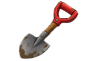 | Remueve cualquier planta del patio (excepto a las plantas de uso instantáneo) |
|  | Permite plantar tus defensas en el patio y recolectar los soles que caen del cielo, al igual que los generados por los Girasoles |
### Plantas

| Imagen | Descripción |
|--------|-------------|
|  | Coste = 50 Vida = 300  |
| 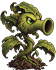 | Coste = 100 Daño = 30 Vida = 300 Ataque = cuerpo a cuerpo |
| 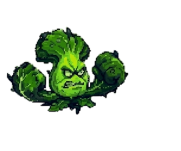 | Coste = 150 Daño = 30 Vida = 300 Ataque = larga distancia|
| 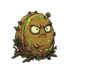 | Vida Daño Velocidad de movimiento  |
| 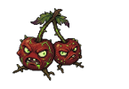 | Vida Daño Velocidad de movimiento  |
| 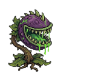 | Vida Daño Velocidad de movimiento  |
### Zoombis

| Imagen | Descripción |
|--------|-------------|
| 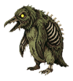 | Vida Daño Velocidad de movimiento  |
| 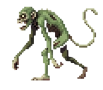 | Vida Daño Velocidad de movimiento  |
| 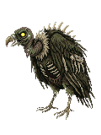 | Vida Daño Velocidad de movimiento  |
|  | Vida Daño Velocidad de movimiento  |
| 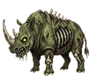 | Vida Daño Velocidad de movimiento  |
| 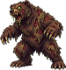 | Vida Daño Velocidad de movimiento  |
| 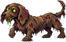 | Vida : ??? Daño : ??? Velocidad de movimiento : media  |

## Controles

Flechas del teclado (↑, ↓, ←, →): permiten mover el cursor por el tablero para elegir la posición en la que se quiere plantar una planta y agarrar soles 

Barra espaciadora: permite recolectar los soles que caen en la posición del cursor
 
Teclas 1 a 6: elegir planta. 1 Girasol, 2 Lanzaguisantes, 3 Nuez, 4 Bonk Choi, 5 Cereza, 6 Planta Carnivora

# Explicaciones

Las explicaciones teóricas y diagramas van a encontrarse en [explicaciones.md](explicaciones.md) a partir del Checkpoint #2.
