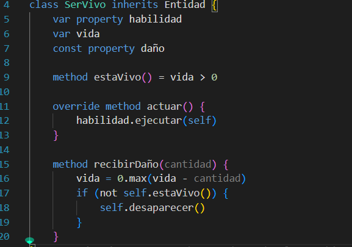
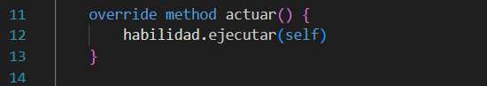
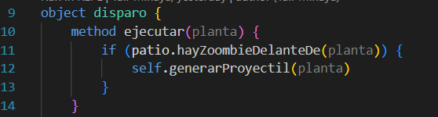
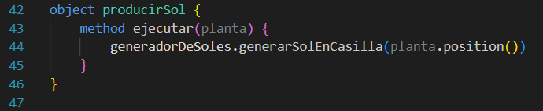
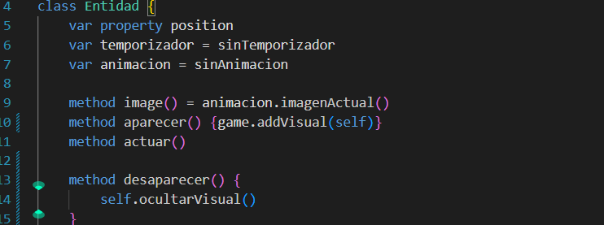

# Explicaciones teóricas

## Encapsulamiento: 

Un objeto esconde cómo está hecho por dentro y deja visible solamente lo que sabe hacer. Quien le envía un mensaje no sabe qué referencias usa ni cómo resuelve lo solicitado. 

### *Dónde lo usamos*
SerVivo esconde su vida, por eso vemos que el var va sin "property" -> no hay getter ni setter. La vida es una referencia interna: nadie puede modificarla desde afuera. Para cambiarla hay una sola manera, recibirDanio, que además garantiza que nunca baje de 0 y que el ser vivo desaparezca cuando muere. 

## Delegación:

Delegar es que un objeto, en lugar de resolver un pedido por sí mismo, se lo encarga a otro objeto que sabe hacerlo mejor. El objeto que delega conoce al otro (tiene una referencia) y le envía un mensaje.

### *Dónde lo usamos*

## Polimorfismo: 

Dos o más objetos son polimórficos cuando entienden el mismo mensaje pero lo resuelven de manera distinta (cada uno tiene su propio método). Quien envía el mensaje no necesita saber con qué objeto está hablando: puede cambiar la referencia sin cambiar su código.

No hace falta que los objetos tengan la misma clase ni una superclase en común, alcanza con que compartan el mensaje. Esto hace que el código esté libre de "IFs" que pregunten qué tipo de objeto es. 

### *Dónde lo usamos*
Las habilidades. TODAS las habilidades entienden ejecutar(...), pero cada una hace algo completamente distinto ante ese mismo mensaje. 

## Herencia: 

La herencia relaciona una clase con otra más general (su superclase). La subclase toma la estructura y el comportamiento de la superclase y puede redefinirlos (override) o agregar los propios. Sirve para reutilizar código y expresar relaciones del tipo "es un": un girasol es una planta, que es un ser vivo.

### *Dónde lo usamos*
Entidad, que es la clase abstracta de todo lo que vive en el tablero. Define lo común (posición, aparecer, desaparecer) y obliga a las subclases a definir image() y actuar(). Además deja métodos vacíos por defecto (avanzar, detenerse) que solo redefine quien los necesita.

# Diagramas

*Incluír al menos un diagrama para comunicar su solución*

Zoombie
   |
   | comer(planta)
   v
Planta
   |
   | recibirDaño(daño)
   v
dañoInflingido
   |
   | procesarDaño(planta, daño)
   v
Planta
   |
   | si corresponde
   v
morir()
   |
   v
game.removeVisual(self)